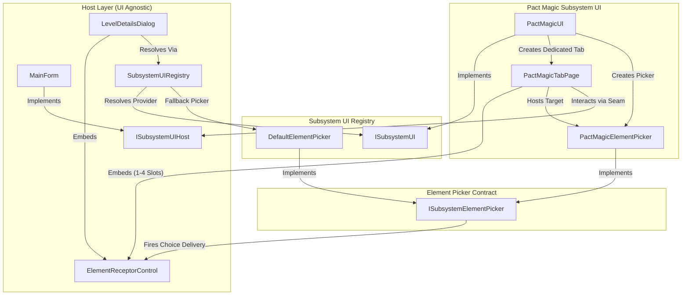

# Subsystem UI Ownership and Composable Element Pickers

## Context

Dungeons & Dragons 3.5e contains a rich, diverse taxonomy of magic and martial subsystems (Pact Magic, Martial Maneuvers, Vancian Spellcasting, Psionics, Incarnum, Truenaming, Shadow Magic, Invocations). While ADR-0006 established a headless, declarative engine architecture (`SubsystemEngine`) driven by primitive verbs and unified persistence, the WinForms UI presentation layer remained monolithically coupled:

1. **Monolithic UI Literacy in `MainForm`**: `MainForm.cs` and `MainForm.Designer.cs` hardcoded Pact Magic controls (`pagVestiges`, `pnlVestige1`, `pnlVestige2`, `optVestige1`, `optVestige2`, `lblPactState`, `lstPactState`, and coordinate ruler panels calculating 206 px horizontal and 20 px vertical buffers). `MainForm` directly managed dynamic column generation, pact state changes, automatic binding check roll prompts via `FormUtils.GetRollResult`, 24-hour timeline unbind action scheduling, and 21-round timeline advances.
2. **Scattered Element Selection Across Dialogs**: Caller dialogs requiring subsystem element selections (such as the *Bind Vestige* or *Martial Study* feat in `LevelDetailsDialog`, or future class feature choices) lacked a composable, reusable UI selection mechanism. Without a standardized picker contract, each dialog risked either implementing bespoke subsystem controls or relying on disruptive modal popups.
3. **Exploratory Workflow vs Modal Dialogs**: Selecting subsystem elements in a live companion requires browsing, reading lore, comparing granted powers, and testing options against character prerequisites. Modal popups obstruct the sheet, destroy spatial context, and force abrupt commitments.
4. **Enable, Don't Enforce (ADR-0001)**: The legacy `MainForm` vestige binding flow automatically prompted for dice rolls and attempted to enforce good versus poor pact state algorithmically. Under ADR-0001, software should enable gameplay without usurping table agency or enforcing checks that a DM or player may handle at the table.

## Decision

We establish subsystem UI ownership, host agnosticism, and composable element picking across five decoupled tiers under `PlayMore35.UI.Subsystems`:



### 1. Subsystem UI Provider Contract (`ISubsystemUI`)

Subsystems own their presentation logic in `PlayMore35.UI.Subsystems.<SubsystemName>`. Each subsystem provides an implementation of `ISubsystemUI`:

```csharp
public interface ISubsystemUI {
    string SubsystemId { get; }
    bool IsActive(ICharacterSession session);
    TabPage? CreateDedicatedTab(ISubsystemUIHost host);
    ISubsystemElementPicker CreateElementPicker(ICharacterSession session, ElementPickerContext context);
}
```

- **Dedicated Tab Lifecycle**: `CreateDedicatedTab` returns a concrete `TabPage` (such as `PactMagicTabPage`) for subsystems requiring a dedicated top-level host tab, or `null` for subsystems that do not (e.g. Invocations or pure resource pools). The returned tab encapsulates its own layout, slot dashboard, and user interaction, managing rendering internally via `TabPage.Enter`.
- **Element Picker Factory**: `CreateElementPicker` instantiates a composable element picker configured for the provided context.
- **Active State Detection**: `IsActive(session)` inspects character progression (e.g. class levels, bound vestiges, martial adept levels, or feat grants) to determine whether the subsystem's dedicated tab should be visible on the host sheet.

### 2. Minimal Host Seam (`ISubsystemUIHost`) & Dynamic Tab Injection

`MainForm` implements `ISubsystemUIHost`, presenting a minimal, four-member interface to dedicated subsystem tabs:

```csharp
public interface ISubsystemUIHost {
    ICharacterSession Session { get; }
    void RequestRecalculate();
    void RequestEffectsRefresh();
    void RequestTimelineRefresh();
}
```

- **Dynamic Tab Injection**: In `MainForm.UpdateSubsystemTabs()`, the form queries `SubsystemUIRegistry.GetAll()`, checks `ui.IsActive(session)`, and injects or removes dedicated `TabPage`s without knowing the subsystem's concrete identity.
- **Complete Decoupling**: Static pact magic controls (`pagVestiges`, `pnlVestige1`, `pnlVestige2`, `optVestige1`, `optVestige2`, `lblPactState`, `lstPactState`, and ruler offsets) and hardcoded pact magic event handlers are completely excised from `MainForm.Designer.cs` and `MainForm.cs`.
- **Dice Rolls Decoupled**: Modal check roll prompts and automatic pact state calculations are eliminated from the host seam. Standalone dialogs needing roll inputs invoke `FormUtils.GetRollResult` directly; host seams do not mandate or coordinate rolls.

### 3. Composable Element Picker (`ISubsystemElementPicker`) & `ElementPickerContext`

Element selection is formalized via `ISubsystemElementPicker`:

```csharp
public interface ISubsystemElementPicker : IDisposable {
    Control Control { get; }
    event Action<SubsystemElement?>? ElementDelivered;
    event Action<IReadOnlyList<SubsystemElement>>? ElementsDelivered;
}
```

- **Decoupled Delivery Paradigm**: The picker delivers its choice via typed events (`ElementDelivered` / `ElementsDelivered`); it does **not** define or own the receptor control. The caller (host form, dialog, or dedicated tab) owns and renders the receptor control, wiring choice delivery to update the receptor.
- **Internal Delivery UX & Exploratory Retention**: Choice delivery timing is an internal UX concern of the picker implementation (e.g., clicking a card immediately delivers the selection). Crucially, the picker **remains displayed** after delivering a choice so the player can explore alternative options, read lore, or change their mind without re-opening dialogs.
- **Parameter Configuration (`ElementPickerContext`)**:
  ```csharp
  public class ElementPickerContext {
      public string ElementType { get; set; } = "";
      public string? Filter { get; set; }
      public int AcquisitionLevel { get; set; }
      public bool MultiSelect { get; set; }
      public IReadOnlyList<string> InitialSelections { get; set; } = Array.Empty<string>();
      public Func<SubsystemElement, IReadOnlyList<string>>? WarningProvider { get; set; }
  }
  ```
  `WarningProvider` evaluates rules prerequisites advisory warnings without hard blocking, driving item warning badges and the picker's "Hide invalid choices" toggle per ADR-0001.

### 4. Element Receptor (`ElementReceptorControl`) & Host Integration (`LevelDetailsDialog`)

- **`ElementReceptorControl`** (`PlayMore35.UI.Subsystems`): A reusable WinForms control representing an element choice:
  - **Visual States**:
    - *Unmade / Available*: Muted border, italic `(Choose element...)` text signaling an unselected slot.
    - *Made / Inactive*: Element name in standard input styling, with an adjacent `WarningBadge` if rules prerequisites are unmet.
    - *Active / Currently Selecting*: Highlighted accent border and background indicating the hosted picker is actively targeting this receptor.
  - **Affordances**:
    - Clicking the receptor activates it and targets/displays the corresponding element picker in the caller's host panel.
    - An inline `✕` clear button (visible when a choice is made) clears the choice back to unselected (`ElementDelivered(null)`).
- **`LevelDetailsDialog` Hosting Seam**:
  - Contains an expandable bottom panel (`pnlPickerHost`), initially hidden (`Visible = false`, height 0).
  - Clicking a feat choice receptor expands `pnlPickerHost`, instantiates the corresponding picker via `SubsystemUIRegistry.GetByElementType(...)`, and wires `ElementDelivered`.
  - When the picker delivers a choice, `LevelDetailsDialog` updates the receptor and validates prerequisites in real time via `session.ValidateFeatChoice(...)`, displaying an advisory `WarningBadge` while keeping the picker open.
  - Clicking a different receptor disposes the previous picker and switches `pnlPickerHost` to the new picker.
  - Changing the parent feat or closing the dialog disposes the active picker and collapses the host panel.
  - `LevelDetailsDialog` maintains zero subsystem literacy.

### 5. Deterministic Subsystem UI Registry (`SubsystemUIRegistry`) & Fallback

- **Deterministic Registry**: `SubsystemUIRegistry` maps subsystem IDs (`"pact_magic"`, `"sublime_way"`) and element type aliases (`"vestige"`, `"maneuver"`, `"stance"`) to `ISubsystemUI` providers via explicit registration in `SubsystemUIRegistry.CreateDefault()`. Zero reflection ensures predictable startup, AOT compatibility, and compile-time verification.
- **Universal Fallback (`DefaultElementPicker`)**: Any subsystem without a specialized picker (or unmigrated subsystems like Sublime Way) returns `DefaultElementPicker` (`PlayMore35.UI.Subsystems`), providing a standardized searchable list, "Hide invalid choices" toggle, item warning badges, and a collapsible details preview pane.

### 6. Pact Magic Tab & Vestige Picker Implementation Specification

The extracted Pact Magic presentation (`PlayMore35.UI.Subsystems.PactMagic`) implements the approved hybrid architecture verified in prototype issue #182:

1. **`PactMagicTabPage` Layout**:
   - **Left Column (360 px)**: Dedicated vertical stack of slot cards scaled to character vestige capacity (1 to 4 slots).
   - **Slot Card Elements**:
     - Slot header (e.g. `Slot 1`).
     - `ElementReceptorControl` rendering bound vestige or `(Choose vestige...)` with an inline `✕` unbind button.
     - `Good` / `Poor` pact radio buttons: disabled when unmade; active and real-time reactive when bound, updating slot state without modal roll prompts.
     - Active symptoms dashboard: displays active physical sign (with good/poor suppression indicators) and granted power summaries for bound vestiges.
   - **Receptor Targeting**: Clicking a slot receptor activates it and targets the right-hand picker to that slot.
2. **`PactMagicElementPicker` Layout**:
   - **Main Panel (Fixed-Size Cards Grid)**: Vestiges render as fixed-size cards (212 × 152 px) inside a vertical scroll container (`AutoScroll = true`), scaling to dozens of catalog vestiges without card distortion. Each card displays Name, Level, Binding DC, sign excerpt, and key granted abilities.
   - **Lower Details Panel (Anchored Bottom)**: Sized dynamically to fit content and anchored to the bottom of the picker space. Displays full *Tome of Magic* rules text, physical sign details, psychological influence, and complete descriptions of all granted abilities.
   - **Reactive Delivery**: Clicking a vestige card immediately invokes `ElementDelivered(vestige)`, updating the active slot receptor and session state while leaving the picker open.
3. **Elimination of Dice Roll Prompts**:
   - Automatic check prompts and modal roll dialogs are removed entirely ("they aren't"). Players select pact states directly via radio buttons, upholding Enable, Don't Enforce (ADR-0001).

## Considered Options

- **Retain and Expand Monolithic `MainForm` Tabs**: Rejected. Hardcoding additional subsystem tabs (Sublime Way, Spells, Psionics) in `MainForm.cs` and `MainForm.Designer.cs` compounds technical debt, leaks subsystem concepts into the main shell, and directly violates ADR-0002 (Systems & Content Separation).
- **Tightly Coupled Picker-Receptor Controls**: Rejected. Combining the choice receptor with the selection list into a single control prevents flexible layouts (e.g. `LevelDetailsDialog`'s compact row layout vs `PactMagicTabPage`'s slot cards dashboard). Decoupling delivery from reception allows arbitrary callers to render choices appropriately for their context.
- **Modal Element Selection Dialogs**: Rejected. Modal popups interrupt user workflow, obscure character stats, prevent comparative exploration of abilities, and break the live combat companion experience.
- **Reflection-Based UI Provider Discovery**: Rejected. Scanning assemblies dynamically is non-deterministic, brittle, and opaque. Explicit registration in `SubsystemUIRegistry.CreateDefault()` guarantees deterministic startup and compile-time safety.
- **Modal Dice Roll Prompts in Host Seam**: Rejected. Forcing binding check rolls upon vestige selection violates ADR-0001 (Enable, Don't Enforce) by stripping table agency. Pact state radio buttons empower players and DMs to record table rolls or GM fiat without UI obstruction.

## Deletion Test Verification

Walking the falsifiable deletion test across the proposed contracts confirms every module earns its keep:
- **Delete `ISubsystemUI`**: Complexity does not vanish; `MainForm` and `LevelDetailsDialog` would have to switch on subsystem names (`switch (subsystemId)`), reintroducing the exact literacy leaks being eliminated.
- **Delete `ISubsystemUIHost`**: Dedicated tabs would require concrete references to `MainForm`, coupling reusable tabs to a single top-level form and breaking testability.
- **Delete `ISubsystemElementPicker`**: Every host context would need custom dialogs or bespoke picker controls for each element type, scattering picker logic across forms.
- **Delete `ElementReceptorControl`**: Every caller would duplicate unmade styling, active selection borders, clear buttons, and warning badge positioning.
- **Delete `SubsystemUIRegistry`**: Callers would directly instantiate concrete subsystem UI classes, leaking subsystem implementations across assembly boundaries.

## Consequences

- Eliminates all Pact Magic literacy and static controls from `MainForm.cs` and `MainForm.Designer.cs`.
- Core engine classes (`SubsystemEngine`, `CharacterSession`) remain 100% headless and UI-agnostic.
- Standardizes composable element picking and receptor controls across character creation, leveling, and live play.
- Establishes a clean, repeatable pattern for future subsystem UI extractions (Sublime Way, Vancian Spellcasting, Psionics, Incarnum).
- Scoped to Pact Magic for initial migration; Sublime Way maneuver picker and dedicated tab deferred to a subsequent effort per user direction.
